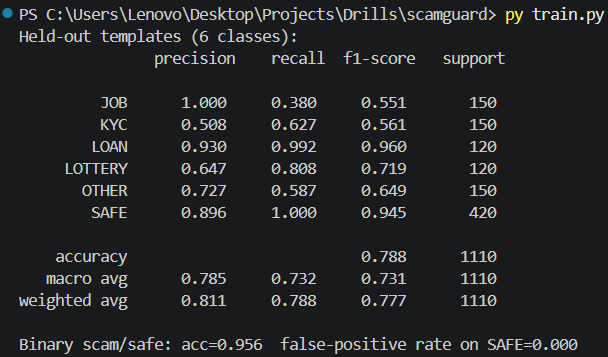
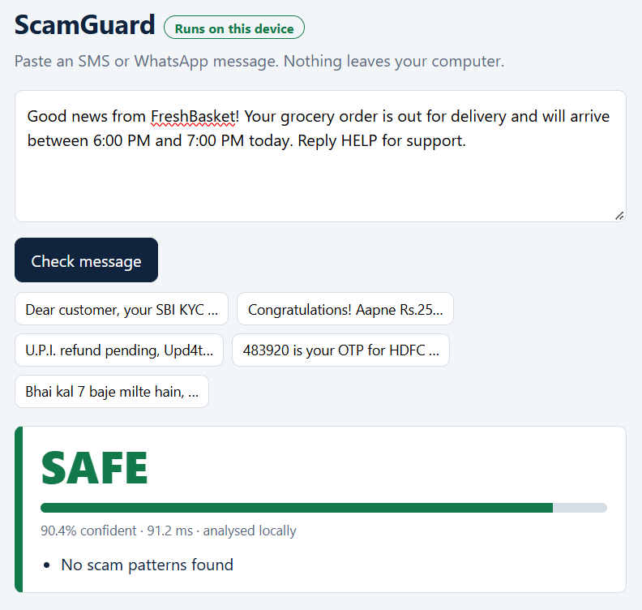
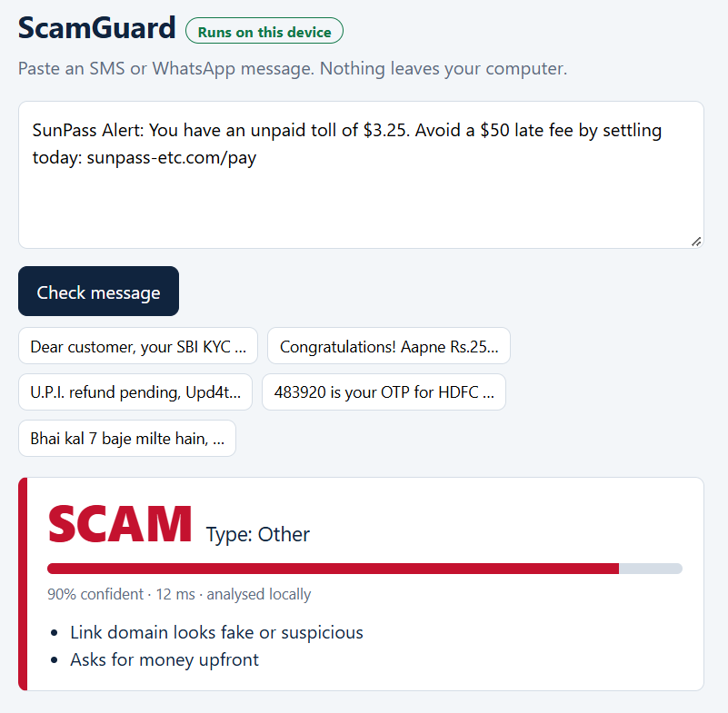
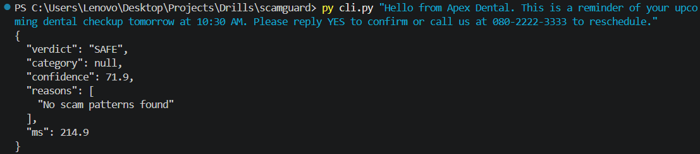
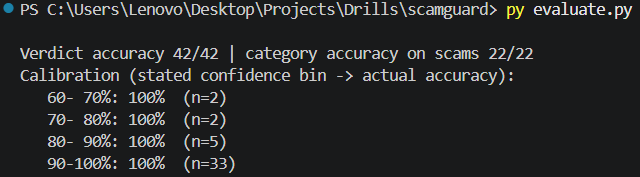
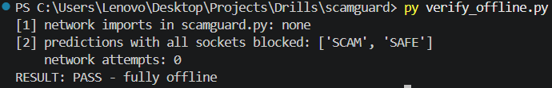

# ScamGuard: On-Device Scam Message Detector

Paste an SMS/WhatsApp message and get **SCAM / SAFE**, a **category** (KYC/Bank, Lottery/Prize, Loan/Credit, Job/Investment, Other), a **confidence %**, and plain-language reasons. Everything runs locally on CPU in about 2-10 ms per message, with no network access.

## Screenshots

### 1. Training and held-out evaluation
`python train.py`


### 2. Web UI: genuine message detected as SAFE


### 3. Web UI: scam message detected with category and confidence


### 4. Command-line interface
`python cli.py "message"`


### 5. Hand-written test set and confidence calibration
`python evaluate.py`


### 6. Offline and privacy verification
`python verify_offline.py`


## Run
```bash
pip install -r requirements.txt
python train.py            # optional: model.joblib is already included
python app.py              # UI at http://127.0.0.1:8000
python cli.py "message"    # command line
python evaluate.py         # hand-written sanity set + calibration
python verify_offline.py   # proof of offline operation
```

## Approach
1. **Normalisation** (`scamguard.py`) defeats obfuscation: leetspeak (`upd4te`), spaced or dotted letters (`K Y C`, `K.Y.C`), Cyrillic homoglyphs, zero-width characters. It masks shortened links, suspicious domains (hyphens, odd TLDs), phone numbers, toll-free numbers, amounts (with a "big amount" flag) and OTP-like digits, so the model learns patterns rather than values.
2. **Model**: word (1-2) + character (2-5) TF-IDF, which handles Hinglish spelling variation, feeding a multinomial Logistic Regression over 6 classes (SAFE + 5 scam types). `P(scam) = 1 - P(SAFE)`, and confidence is the probability of the stated verdict. If no scam class holds at least 50% of the scam probability, the category falls back to **Other**.
3. **Explainability**: rule-based red flags (shortened link, urgency, threats, OTP/bank-detail requests, upfront fees, fake prizes) explain each verdict.
4. **Legitimate messages stay safe**: the training data includes genuine bank debit/credit alerts, OTPs, delivery/utility updates, a genuine "KYC updated" notice, and personal chats in English and Hinglish that use words like "urgent", "loan", "lottery" and "congratulations".

## Data
No internet was used, so the corpus is generated by `data.py`. It combines about 150 hand-written templates and composable hook + urgency + call-to-action fragments in English and Hinglish, filled with random banks, links, phone numbers and amounts, with obfuscation applied to about 35% of scams. **Evaluation holds out whole templates and hooks** (unseen wordings), not random rows. To improve real-world accuracy, put real labelled messages in `extra.csv` (`text,label`; labels SAFE/KYC/LOTTERY/LOAN/JOB/OTHER) and re-run `train.py`; they are merged automatically.

## Results (reproducible with `python train.py` and `python evaluate.py`)
| Test | Result |
|---|---|
| Held-out templates, scam vs safe | ~95.6% accuracy, 0% false positives on genuine messages |
| Held-out templates, 6-class | weighted F1 ~0.78 (hardest case: unseen scam wordings) |
| Hand-written set (42 messages, wordings not in the generator) | 42/42 verdicts, 22/22 categories |
| Confidence calibration | higher stated confidence tracks higher accuracy (see `evaluate.py`) |
| Speed | ~2-10 ms per message, model about 0.5 MB, CPU only |

The hand-written set is a small sanity check. It was used while developing, so it is not a clean unseen test.

## Verifying offline and private operation
- `python verify_offline.py` statically checks that the core code imports no networking module, then makes every socket operation raise and confirms the detector still returns correct results with zero network attempts.
- The UI server binds to `127.0.0.1` only and uses the standard library, with no external fonts, scripts or CDNs. Messages are never written to disk or logged.
- Independent check: disconnect Wi-Fi or run `unshare -n python app.py` (Linux) and the app works unchanged.

## Limitations
The model was trained on synthetic data, so real-world accuracy depends on adding real messages (`extra.csv`). Non-Latin scripts (e.g. Devanagari) get only character-level support.

## AI-assistance credit
The Project was Built with some AI assistance (Claude). Libraries: scikit-learn, joblib, numpy.
